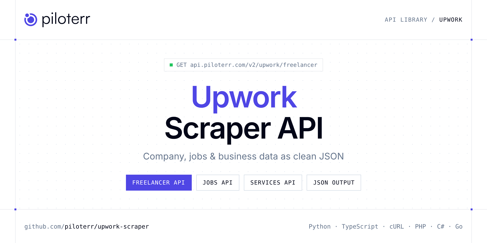

<p align="center">
  <a href="https://www.piloterr.com"></a>
</p>

# Upwork Scraper API

[](https://discord.gg/CFj3ph8aHU) [](https://app.piloterr.com) [](https://app.piloterr.com/openapi) [](LICENSE)

The **Piloterr Upwork Scraper API** lets you extract public data from Upwork as **clean, structured JSON** — no proxies, headless browsers or HTML parsing to maintain. Endpoints available in production:

- **Upwork Freelancer API** — Upwork Freelancer API: fetch public freelancer profile data from a profile ID, username or URL.
- **Upwork Jobs API** — Upwork Jobs API: search freelance job listings by skill slug or URL.
- **Upwork Services API** — Upwork Services API: browse Project Catalog listings by category slug or URL.
- **Upwork Services Info API** — Upwork Services Info API: fetch Project Catalog product details from a product URL.

Use it for lead generation, CRM enrichment, market mapping, investment research or job market analytics.

| Endpoint | Path | Credits | What you get |
|---|---|---|---|
| [Upwork Freelancer API](#upwork-freelancer-api) | `/v2/upwork/freelancer` | 2 | Upwork Freelancer API |
| [Upwork Jobs API](#upwork-jobs-api) | `/v2/upwork/jobs` | 2 | Upwork Jobs API |
| [Upwork Services API](#upwork-services-api) | `/v2/upwork/services` | 2 | Upwork Services API |
| [Upwork Services Info API](#upwork-services-info-api) | `/v2/upwork/services/info` | 2 | Upwork Services Info API |

## Table of contents

- [How it works](#how-it-works)
- [Upwork Freelancer API](#upwork-freelancer-api)
- [Upwork Jobs API](#upwork-jobs-api)
- [Upwork Services API](#upwork-services-api)
- [Upwork Services Info API](#upwork-services-info-api)
- [Code examples in other languages](#code-examples-in-other-languages)
- [Practical use cases](#practical-use-cases)
- [Why Piloterr?](#why-piloterr)
- [FAQ](#faq)
- [Related scrapers](#related-scrapers)
- [Support](#support)

## How it works

1. **Create a free Piloterr account** and copy your API key from the [dashboard](https://app.piloterr.com).
2. **Send a `GET` (or `POST`) request** to `https://api.piloterr.com/v2/...` with the header `x-api-key: YOUR_API_KEY`.
3. **Receive structured JSON** — Piloterr handles rendering, proxies, retries and parsing.

```bash
export PILOTERR_API_KEY="your-api-key"
pip install requests        # Python
# TypeScript: Node.js 18+ (native fetch), run with `npx tsx file.ts`
```

> Every endpoint accepts both `GET` (query string) and `POST` (JSON body with the same fields).

## Upwork Freelancer API

Upwork Freelancer API: fetch public freelancer profile data from a profile ID, username or URL. Returns bio, hourly rate, skills, ratings and agency info via browser rendering.

`GET | POST https://api.piloterr.com/v2/upwork/freelancer` · **2 credits per request** · [Full reference](https://app.piloterr.com/openapi)

### Request parameters

| Parameter | Type | Required | Description |
|---|---|---|---|
| `query` | string | ✅ | Upwork freelancer profile ID, username, or full profile URL. |
| `return_page_source` | boolean | — | When `true`, return the raw HTML page source as `{"result": "..."}` instead of structured JSON. Defaults to `false`. |

### Python example

```python
import json
import os
import requests

response = requests.get(
    "https://api.piloterr.com/v2/upwork/freelancer",
    headers={"x-api-key": os.environ["PILOTERR_API_KEY"]},
    params={
        "query": "~0123456789abcdef01",
    },
    timeout=60,
)
response.raise_for_status()
data = response.json()

print(json.dumps(data, indent=2, ensure_ascii=False)[:2000])
```

### TypeScript example

```typescript
type UpworkFreelancer = {
  url?: string;
  name?: string;
  title?: string;
  rating?: number;
  skills?: string[];
  user_id?: string;
  currency?: string;
  location?: string;
  username?: unknown;
  verified?: boolean;
  is_agency?: boolean;
  profile_id?: string;
  agency_name?: string;
  description?: string;
  hourly_rate?: number;
  total_hours?: number;
  review_count?: number;
  job_success_score?: number;
  profile_image_url?: string;
};

const params = new URLSearchParams({
  "query": "~0123456789abcdef01",
});

const response = await fetch(`https://api.piloterr.com/v2/upwork/freelancer?${params}`, {
  headers: { "x-api-key": process.env.PILOTERR_API_KEY! },
});
if (!response.ok) throw new Error(`Piloterr error ${response.status}: ${await response.text()}`);

const data = (await response.json()) as UpworkFreelancer;

console.log(JSON.stringify(data, null, 2).slice(0, 2000));
```

<details>
<summary><b>POST variant</b></summary>

```http
POST https://api.piloterr.com/v2/upwork/freelancer
x-api-key: YOUR_API_KEY
Content-Type: application/json

{"query": "~0123456789abcdef01"}
```
</details>

### Output example

Response shape with placeholder values — field names follow the API reference.

```json
{
  "url": "example",
  "name": "example",
  "title": "example",
  "rating": 0,
  "skills": [
    "example"
  ],
  "user_id": "example",
  "currency": "example",
  "location": "example",
  "username": "example",
  "verified": false,
  "is_agency": false,
  "profile_id": "example",
  "agency_name": "example",
  "description": "example",
  "hourly_rate": 0,
  "total_hours": 0,
  "review_count": 0,
  "job_success_score": 0,
  "profile_image_url": "example"
}
```

### Response fields

| Field | Type | Description |
|---|---|---|
| `url` | string |  |
| `name` | string |  |
| `title` | string |  |
| `rating` | number |  |
| `skills` | string[] |  |
| `user_id` | string |  |
| `currency` | string |  |
| `location` | string |  |
| `username` | object |  |
| `verified` | boolean |  |
| `is_agency` | boolean |  |
| `profile_id` | string |  |
| `agency_name` | string |  |
| `description` | string |  |
| `hourly_rate` | integer |  |
| `total_hours` | integer |  |
| `review_count` | integer |  |
| `job_success_score` | integer |  |
| `profile_image_url` | string |  |

## Upwork Jobs API

Upwork Jobs API: search freelance job listings by skill slug or URL. Returns budgets, skills, experience level and pagination via browser rendering.

`GET | POST https://api.piloterr.com/v2/upwork/jobs` · **2 credits per request** · [Full reference](https://app.piloterr.com/openapi)

### Request parameters

| Parameter | Type | Required | Description |
|---|---|---|---|
| `query` | string | ✅ | Upwork skill slug or full freelance-jobs URL. |
| `return_page_source` | boolean | — | When `true`, return the raw HTML page source as `{"result": "..."}` instead of structured JSON. Defaults to `false`. |

### Python example

```python
import json
import os
import requests

response = requests.get(
    "https://api.piloterr.com/v2/upwork/jobs",
    headers={"x-api-key": os.environ["PILOTERR_API_KEY"]},
    params={
        "query": "api-development",
    },
    timeout=60,
)
response.raise_for_status()
data = response.json()

print(json.dumps(data, indent=2, ensure_ascii=False)[:2000])
```

### TypeScript example

```typescript
type UpworkJobs = {
  skill?: string;
  title?: string;
  results?: {
    title?: string;
    job_id?: string;
    skills?: string[];
    currency?: string;
    duration?: string;
    job_type?: string;
    posted_at?: string;
    budget_max?: unknown;
    budget_min?: number;
    posted_ago?: string;
    description?: string;
    listing_url?: string;
    hours_per_week?: unknown;
    experience_level?: string;
  }[];
  pagination?: {
    next?: unknown;
    page?: number;
    per_page?: number;
    total_pages?: number;
    total_results?: number;
  };
};

const params = new URLSearchParams({
  "query": "api-development",
});

const response = await fetch(`https://api.piloterr.com/v2/upwork/jobs?${params}`, {
  headers: { "x-api-key": process.env.PILOTERR_API_KEY! },
});
if (!response.ok) throw new Error(`Piloterr error ${response.status}: ${await response.text()}`);

const data = (await response.json()) as UpworkJobs;

console.log(JSON.stringify(data, null, 2).slice(0, 2000));
```

<details>
<summary><b>POST variant</b></summary>

```http
POST https://api.piloterr.com/v2/upwork/jobs
x-api-key: YOUR_API_KEY
Content-Type: application/json

{"query": "api-development"}
```
</details>

### Output example

Example response from the API reference, abridged — real values depend on the page you scrape.

```json
{
  "skill": "api-development",
  "title": "Find the Best API Developer Jobs",
  "results": [
    {
      "title": "Full-stack Shopify + Make.com + Gemini AI Automation Setup",
      "job_id": "022071658395247542131",
      "skills": [
        "HTML",
        "HTML5"
      ],
      "currency": "USD",
      "duration": "1 to 3 months",
      "job_type": "fixed",
      "posted_at": "2026-06-29T18:13:45+0000",
      "budget_max": null,
      "budget_min": 800,
      "posted_ago": "14 hours ago",
      "description": "Dear Expert,\nBelow you can find a description of my project where your expertise would be needed.\nProject Overview: I am looking for a fu…",
      "listing_url": "https://www.upwork.com/freelance-jobs/apply/Full-stack-Shopify-Make-com-Gemini-Automation-Setup_~022071658395247542131/",
      "hours_per_week": null,
      "experience_level": "Expert"
    },
    {
      "title": "Looking for an AI Agent Developer for Social Media Automation",
      "job_id": "022071659921584263119",
      "skills": [
        "Lead Generation",
        "Artificial Intelligence"
      ],
      "currency": "USD",
      "duration": "1 to 3 months",
      "job_type": "fixed",
      "posted_at": "2026-06-29T18:19:49+0000",
      "budget_max": null,
      "budget_min": 13000,
      "posted_ago": "13 hours ago",
      "description": "I am looking to build an AI agent that can manage and handle social media profiles across platforms like Facebook, Instagram, LinkedIn, a…",
      "listing_url": "https://www.upwork.com/freelance-jobs/apply/Looking-for-Agent-Developer-for-Social-Media-Automation_~022071659921584263119/",
      "hours_per_week": null,
      "experience_level": "Expert"
    }
  ],
  "pagination": {
    "next": null,
    "page": 1,
    "per_page": 30,
    "total_pages": 206,
    "total_results": 6156
  }
}
```

### Response fields

| Field | Type | Description |
|---|---|---|
| `skill` | string |  |
| `title` | string |  |
| `results[]` | object[] |  |
| `results[].title` | string |  |
| `results[].job_id` | string |  |
| `results[].skills` | string[] |  |
| `results[].currency` | string |  |
| `results[].duration` | string |  |
| `results[].job_type` | string |  |
| `results[].posted_at` | string |  |
| `results[].budget_max` | object |  |
| `results[].budget_min` | integer |  |
| `results[].posted_ago` | string |  |
| `results[].description` | string |  |
| `results[].listing_url` | string |  |
| `results[].hours_per_week` | object |  |
| `results[].experience_level` | string |  |
| `pagination` | object |  |
| `pagination.next` | object |  |
| `pagination.page` | integer |  |
| `pagination.per_page` | integer |  |
| `pagination.total_pages` | integer |  |
| `pagination.total_results` | integer |  |

## Upwork Services API

Upwork Services API: browse Project Catalog listings by category slug or URL. Returns prices, product IDs and pagination via browser rendering.

`GET | POST https://api.piloterr.com/v2/upwork/services` · **2 credits per request** · [Full reference](https://app.piloterr.com/openapi)

### Request parameters

| Parameter | Type | Required | Description |
|---|---|---|---|
| `query` | string | ✅ | Upwork Project Catalog category slug or full services URL. |
| `return_page_source` | boolean | — | When `true`, return the raw HTML page source as `{"result": "..."}` instead of structured JSON. Defaults to `false`. |

### Python example

```python
import json
import os
import requests

response = requests.get(
    "https://api.piloterr.com/v2/upwork/services",
    headers={"x-api-key": os.environ["PILOTERR_API_KEY"]},
    params={
        "query": "mobile-apps",
    },
    timeout=60,
)
response.raise_for_status()
data = response.json()

print(json.dumps(data, indent=2, ensure_ascii=False)[:2000])
```

### TypeScript example

```typescript
type UpworkServices = {
  name?: string;
  results?: {
    title?: string;
    rating?: unknown;
    currency?: string;
    image_url?: string;
    price_from?: number;
    product_id?: string;
    listing_url?: string;
  }[];
  category?: string;
  pagination?: {
    next?: unknown;
    page?: number;
    per_page?: number;
    total_pages?: unknown;
    total_results?: unknown;
  };
};

const params = new URLSearchParams({
  "query": "mobile-apps",
});

const response = await fetch(`https://api.piloterr.com/v2/upwork/services?${params}`, {
  headers: { "x-api-key": process.env.PILOTERR_API_KEY! },
});
if (!response.ok) throw new Error(`Piloterr error ${response.status}: ${await response.text()}`);

const data = (await response.json()) as UpworkServices;

console.log(JSON.stringify(data, null, 2).slice(0, 2000));
```

<details>
<summary><b>POST variant</b></summary>

```http
POST https://api.piloterr.com/v2/upwork/services
x-api-key: YOUR_API_KEY
Content-Type: application/json

{"query": "mobile-apps"}
```
</details>

### Output example

Example response from the API reference, abridged — real values depend on the page you scrape.

```json
{
  "name": "Mobile Apps",
  "results": [
    {
      "title": "Mobile App Development | Android Apps | iOS Apps | Flutter Application DevMobile App Development | Android Apps | iOS Apps | Flutter Appl…",
      "rating": null,
      "currency": "USD",
      "image_url": "https://res.cloudinary.com/upwork-cloud/image/upload/c_scale,w_400/v1765222199/catalog/1403673770703212544/lxul06rynupzvk1jkz8s.jpg",
      "price_from": 399,
      "product_id": "1403673770703212544",
      "listing_url": "https://www.upwork.com/services/product/development-it-mobile-app-developer-android-ios-flutter-application-hybrid-apps-1403673770703212544"
    },
    {
      "title": "Mobile App Developer, Android, iOS App Development in Flutter, App DesignerMobile App Developer, Android, iOS App Development in Flutter,…",
      "rating": null,
      "currency": "USD",
      "image_url": "https://res.cloudinary.com/upwork-cloud/image/upload/c_scale,w_400/v1750666442/catalog/1784861153261067753/p9oduz9tvcfgpomnqqow.jpg",
      "price_from": 499,
      "product_id": "1784861153261067753",
      "listing_url": "https://www.upwork.com/services/product/development-it-android-ios-mobile-app-development-using-flutter-expert-ai-app-developer-178486115…"
    }
  ],
  "category": "mobile-apps",
  "pagination": {
    "next": null,
    "page": 1,
    "per_page": 24,
    "total_pages": null,
    "total_results": null
  }
}
```

### Response fields

| Field | Type | Description |
|---|---|---|
| `name` | string |  |
| `results[]` | object[] |  |
| `results[].title` | string |  |
| `results[].rating` | object |  |
| `results[].currency` | string |  |
| `results[].image_url` | string |  |
| `results[].price_from` | integer |  |
| `results[].product_id` | string |  |
| `results[].listing_url` | string |  |
| `category` | string |  |
| `pagination` | object |  |
| `pagination.next` | object |  |
| `pagination.page` | integer |  |
| `pagination.per_page` | integer |  |
| `pagination.total_pages` | object |  |
| `pagination.total_results` | object |  |

## Upwork Services Info API

Upwork Services Info API: fetch Project Catalog product details from a product URL. Returns packages, pricing, seller, media and breadcrumbs via browser rendering.

`GET | POST https://api.piloterr.com/v2/upwork/services/info` · **2 credits per request** · [Full reference](https://app.piloterr.com/openapi)

### Request parameters

| Parameter | Type | Required | Description |
|---|---|---|---|
| `query` | string | ✅ | Full Upwork Project Catalog product URL. |
| `return_page_source` | boolean | — | When `true`, return the raw HTML page source as `{"result": "..."}` instead of structured JSON. Defaults to `false`. |

### Python example

```python
import json
import os
import requests

response = requests.get(
    "https://api.piloterr.com/v2/upwork/services/info",
    headers={"x-api-key": os.environ["PILOTERR_API_KEY"]},
    params={
        "query": "https://www.upwork.com/services/product/development-it-mobile-app-developer-android-ios-flutter-application-hybrid-apps-1403673770703212544",
    },
    timeout=60,
)
response.raise_for_status()
data = response.json()

print(json.dumps(data, indent=2, ensure_ascii=False)[:2000])
```

### TypeScript example

```typescript
type UpworkServicesInfo = {
  url?: string;
  name?: string;
  media?: string[];
  rating?: number;
  seller?: {
    url?: string;
    name?: string;
  };
  pricing?: {
    currency?: string;
    price_max?: number;
    price_min?: number;
  };
  packages?: {
    name?: string;
    price?: number;
    currency?: string;
    delivery_days?: number;
  }[];
  product_id?: string;
  breadcrumbs?: string[];
  description?: string;
  review_count?: number;
};

const params = new URLSearchParams({
  "query": "https://www.upwork.com/services/product/development-it-mobile-app-developer-android-ios-flutter-application-hybrid-apps-1403673770703212544",
});

const response = await fetch(`https://api.piloterr.com/v2/upwork/services/info?${params}`, {
  headers: { "x-api-key": process.env.PILOTERR_API_KEY! },
});
if (!response.ok) throw new Error(`Piloterr error ${response.status}: ${await response.text()}`);

const data = (await response.json()) as UpworkServicesInfo;

console.log(JSON.stringify(data, null, 2).slice(0, 2000));
```

<details>
<summary><b>POST variant</b></summary>

```http
POST https://api.piloterr.com/v2/upwork/services/info
x-api-key: YOUR_API_KEY
Content-Type: application/json

{"query": "https://www.upwork.com/services/product/development-it-mobile-app-developer-android-ios-flutter-application-hybrid-apps-1403673770703212544"}
```
</details>

### Output example

Example response from the API reference, abridged — real values depend on the page you scrape.

```json
{
  "url": "https://www.upwork.com/services/product/development-it-mobile-app-developer-android-ios-flutter-application-hybrid-apps-1403673770703212544",
  "name": "You will get Mobile App Development | Android Apps | iOS Apps | Flutter Application Dev",
  "media": [
    "https://www.upwork.com/profile-portraits/c1vxfieoLCtKwfBvgMJOsjDJ0V5yef3ZDUIb_LI85bAA7wkPjr-AyXZ3QyfHCzOZqZ",
    "https://www.upwork.com/profile-portraits/c1vxfieoLCtKwfBvgMJOsjDJ0V5yef3ZDUIb_LI85bAA6jLFePDbCqtoc1d4MPZG-3"
  ],
  "rating": 4.95,
  "seller": {
    "url": "example",
    "name": "example"
  },
  "pricing": {
    "currency": "USD",
    "price_max": 2999,
    "price_min": 399
  },
  "packages": [
    {
      "name": "Starter",
      "price": 399,
      "currency": "USD",
      "delivery_days": 7
    },
    {
      "name": "Standard",
      "price": 1299,
      "currency": "USD",
      "delivery_days": 25
    }
  ],
  "product_id": "1403673770703212544",
  "breadcrumbs": [
    "Project Catalog",
    "Development & IT"
  ],
  "description": "Building a successful mobile app requires strong engineering, smooth interface design, and reliable performance. I create high-quality An…",
  "review_count": 1096
}
```

### Response fields

| Field | Type | Description |
|---|---|---|
| `url` | string |  |
| `name` | string |  |
| `media` | string[] |  |
| `rating` | number |  |
| `seller` | object |  |
| `seller.url` | string |  |
| `seller.name` | string |  |
| `pricing` | object |  |
| `pricing.currency` | string |  |
| `pricing.price_max` | integer |  |
| `pricing.price_min` | integer |  |
| `packages[]` | object[] |  |
| `packages[].name` | string |  |
| `packages[].price` | integer |  |
| `packages[].currency` | string |  |
| `packages[].delivery_days` | integer |  |
| `product_id` | string |  |
| `breadcrumbs` | string[] |  |
| `description` | string |  |
| `review_count` | integer |  |

## Code examples in other languages

Ready-to-run examples live in the [`examples/`](examples) folder. Each one reads your key from the `PILOTERR_API_KEY` environment variable.

| Language | Freelancer | Jobs | Services | Services Info |
|---|---|---|---|---|
| cURL (Bash) | [`freelancer`](examples/curl/freelancer.sh) | [`jobs`](examples/curl/jobs.sh) | [`services`](examples/curl/services.sh) | [`services-info`](examples/curl/services_info.sh) |
| PHP | [`freelancer`](examples/php/freelancer.php) | [`jobs`](examples/php/jobs.php) | [`services`](examples/php/services.php) | [`services-info`](examples/php/services_info.php) |
| C# | [`freelancer`](examples/csharp/Freelancer.cs) | [`jobs`](examples/csharp/Jobs.cs) | [`services`](examples/csharp/Services.cs) | [`services-info`](examples/csharp/ServicesInfo.cs) |
| Go | [`freelancer`](examples/go/freelancer.go) | [`jobs`](examples/go/jobs.go) | [`services`](examples/go/services.go) | [`services-info`](examples/go/services_info.go) |
| Java | [`freelancer`](examples/java/FreelancerExample.java) | [`jobs`](examples/java/JobsExample.java) | [`services`](examples/java/ServicesExample.java) | [`services-info`](examples/java/ServicesInfoExample.java) |
| Ruby | [`freelancer`](examples/ruby/freelancer.rb) | [`jobs`](examples/ruby/jobs.rb) | [`services`](examples/ruby/services.rb) | [`services-info`](examples/ruby/services_info.rb) |
| Node.js | [`freelancer`](examples/nodejs/freelancer.mjs) | [`jobs`](examples/nodejs/jobs.mjs) | [`services`](examples/nodejs/services.mjs) | [`services-info`](examples/nodejs/services_info.mjs) |

## Practical use cases

- **Lead generation** — Build target account lists from public company data.
- **CRM enrichment** — Keep firmographics, websites and descriptions up to date.
- **Market mapping** — Map competitors and segments across countries and industries.
- **Investment research** — Screen companies, funding and signals for deal flow.
- **Job market analytics** — Track hiring, roles and salaries where available.

## Why Piloterr?

- **No infrastructure** — no proxies, headless browsers or CAPTCHA solving to run yourself.
- **Structured JSON** — stable, documented fields instead of brittle HTML selectors.
- **Pay per request** — transparent credit cost per endpoint, failed requests are retried for you.
- **One API key, hundreds of sources** — Upwork plus many other e-commerce, search and company data endpoints in the [Piloterr library](https://www.piloterr.com/library).
- **Any language** — plain HTTPS + JSON, with examples for Python, TypeScript, cURL, PHP, C#, Go, Java, Ruby and Node.js.

## FAQ

### Is it legal to scrape Upwork?

Collecting publicly available data is generally allowed in many jurisdictions, but rules depend on your country, the data you collect and how you use it. Avoid personal data unless you have a lawful basis, respect the website's terms where they apply, and get legal advice for your specific use case. This is not legal advice.

### Do I need proxies or a headless browser?

No. Piloterr handles rendering, proxy rotation and retries on its side. You only send an HTTPS request with your `x-api-key` header and receive JSON.

### How much does a request cost?

Credits per call: `/v2/upwork/freelancer` **2**, `/v2/upwork/jobs` **2**, `/v2/upwork/services` **2**, `/v2/upwork/services/info` **2**. See the [Piloterr website](https://www.piloterr.com) for plans.

### What data does the Upwork API return?

Each endpoint returns structured JSON: **Upwork Freelancer** — `url`, `name`, `title`, `rating`, `skills`, `user_id`; **Upwork Jobs** — `skill`, `title`, `results[]`, `results[].title`, `results[].job_id`, `results[].skills`; **Upwork Services** — `name`, `results[]`, `results[].title`, `results[].rating`, `results[].currency`, `results[].image_url`; **Upwork Services Info** — `url`, `name`, `media`, `rating`, `seller`, `seller.url`.

### Can I get the raw HTML instead of JSON?

Yes. Set `return_page_source=true` and the response becomes `{"result": "..."}` with the page source.

### Which languages are supported?

Any language that can make an HTTP request. This README shows Python and TypeScript; the [`examples/`](examples) folder contains cURL, PHP, C#, Go, Java, Ruby and Node.js.

## Related scrapers

- [Company Database Scraper API](https://github.com/piloterr/company-data-api)
- [Crunchbase Scraper API](https://github.com/piloterr/crunchbase-scraper)
- [Europages Scraper API](https://github.com/piloterr/europages-scraper)
- [Fiverr Scraper API](https://github.com/piloterr/fiverr-scraper)
- [G2 Scraper API](https://github.com/piloterr/g2-scraper)
- [GitHub Scraper API](https://github.com/piloterr/github-scraper)
- [All Piloterr scrapers on GitHub](https://github.com/piloterr)

## Support

- 💬 Join the [Piloterr Discord](https://discord.gg/CFj3ph8aHU) to ask questions and share what you build.
- 📚 Browse the [API reference (OpenAPI)](https://app.piloterr.com/openapi) and the [Piloterr library](https://www.piloterr.com/library).
- 🔑 [Get your API key](https://app.piloterr.com).

---

<p align="center">
  <a href="https://www.piloterr.com">
    <picture>
      <source media="(prefers-color-scheme: dark)" srcset="images/logo-dark.svg">
      
    </picture>
  </a>
  <br>
  <sub>Built by <a href="https://www.piloterr.com">Piloterr</a> — web scraping APIs for e-commerce, search, real estate and more, one API key.</sub>
</p>

<sub>Upwork is a trademark of its respective owner. This repository is not affiliated with or endorsed by Upwork. Examples are released under the MIT license.</sub>
